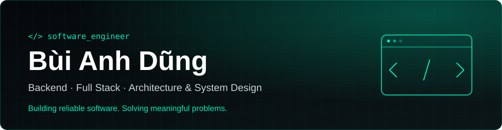

  

  
  
  

<b>Learn. Build. Share.</b>

---

## 👋 About

I am a software engineer focused on backend systems and the architecture behind them. I learn by building, then I write down what I built **and what I could not verify**. I do not claim scale or production readiness without evidence.

## 🎯 Engineering focus

| | |
|---|---|
| **Backend engineering** | REST APIs, authentication, data modelling, transactions, idempotency |
| **Full stack development** | Typed contracts between a NestJS API and a Next.js client |
| **Architecture and system design** | Service boundaries, realtime messaging, payment-state workflows |

## 🧰 Technical stack

Tools used in my projects.

  
  
  
  
  
  
  
  
  
  
  
  
  

📚 *Currently studying:* database internals and system design at scale.

## 🚀 Featured projects

<table>
<tr>
<td width="50%" valign="top">

### 🧸 TeddyPet
E-commerce built as cooperating services: commerce API, storefront and admin, media service and realtime support chat.

`NestJS` `Prisma` `PostgreSQL` `Redis` `MongoDB` `Next.js` `Socket.IO`

- **Implemented:** order and payment workflow, VNPay integration, JWT auth, OpenAPI-generated frontend types, chat over REST and WebSocket
- **Not yet verified:** VNPay Sandbox with a public HTTPS callback; no load or latency measurements

</td>
<td width="50%" valign="top">

### 📝 Dev Journal
Single-author technical blog with a custom CMS.

`Next.js` `Tiptap` `Prisma` `PostgreSQL` `Better Auth`

- **Implemented and tested:** public blog, admin editor, publish lifecycle, media upload. 75 unit/integration and 25 E2E tests passed when last recorded (2026-11-19)
- **Not yet done:** production deployment

</td>
</tr>
</table>

> The TeddyPet and Dev Journal repositories are currently private. Documentation and case studies will be linked here when they are published.

## 🗂️ Other repositories

[DuAn_BE](https://github.com/buianhdung1612/DuAn_BE) · [Du_An_FE](https://github.com/buianhdung1612/Du_An_FE) · [WDP301_BE](https://github.com/buianhdung1612/WDP301_BE) · [WDP301_FE](https://github.com/buianhdung1612/WDP301_FE) · [Project-SWP391](https://github.com/buianhdung1612/Project-SWP391) · [project-5-fe](https://github.com/buianhdung1612/project-5-fe)

---

Building reliable software. Solving meaningful problems.

